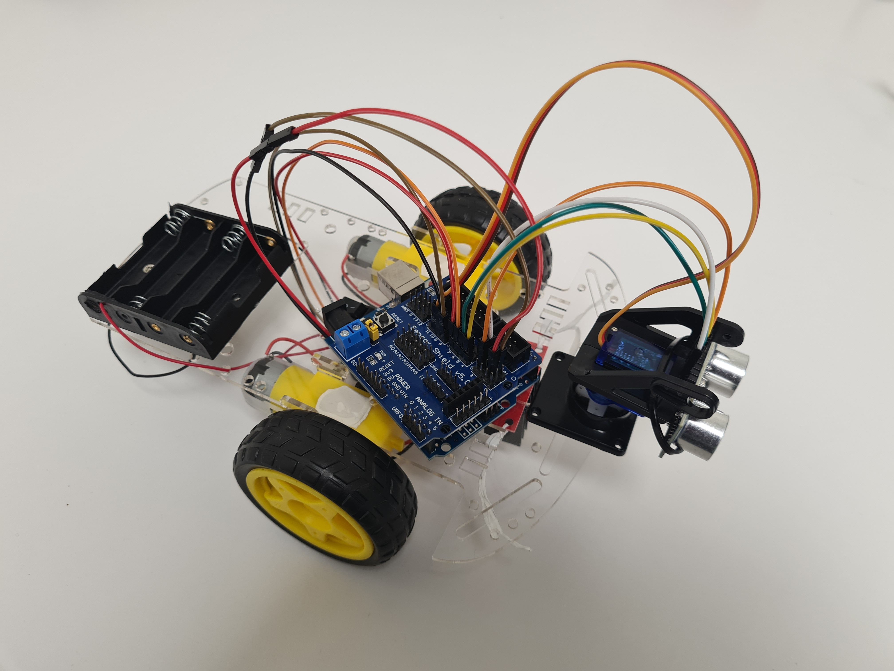
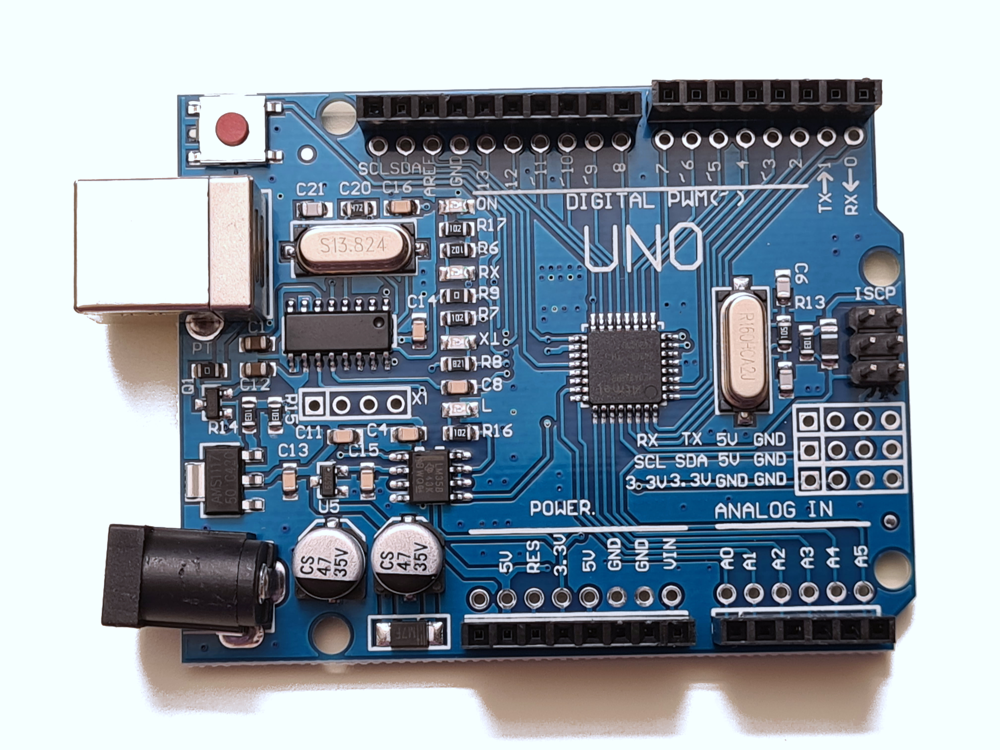
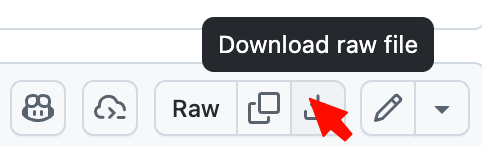
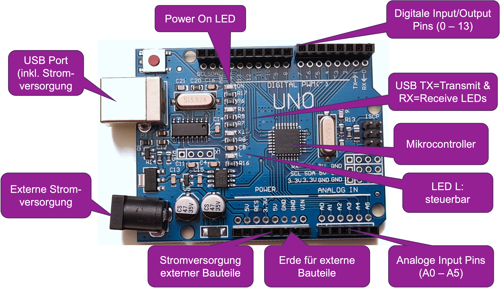
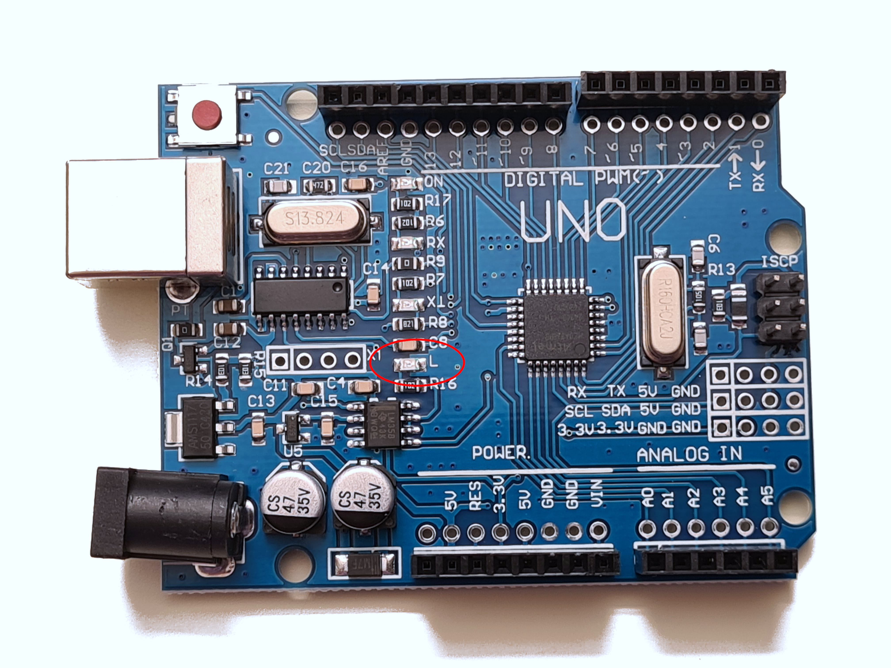
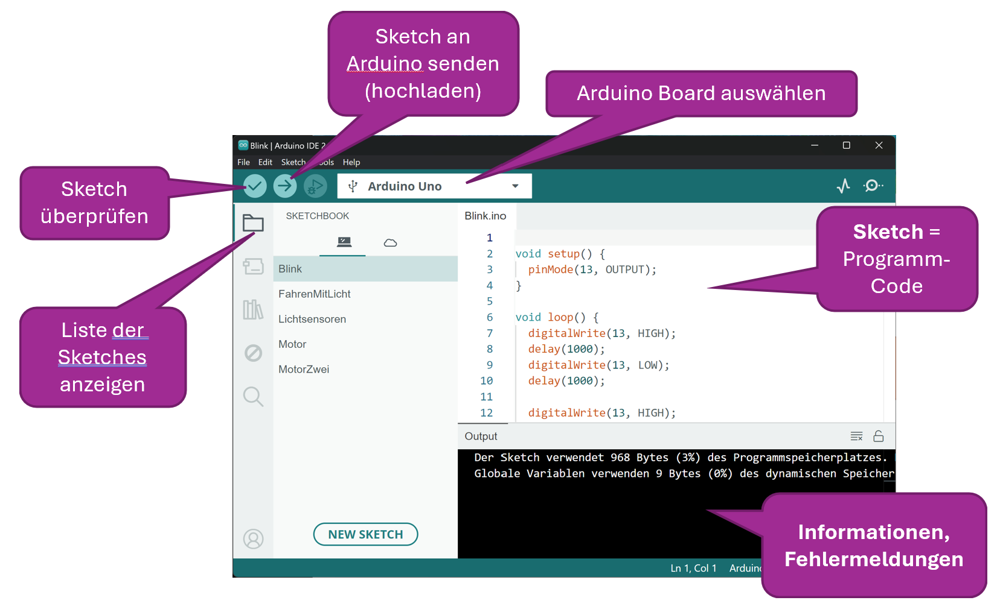
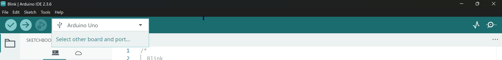
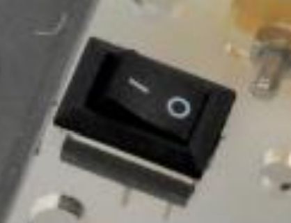

# BMFH-SmartBots
Willkommen zum SmartBots Kurs! 
Hier findest du alle nötigen Materialien und Informationen.



Wir werden einen Roboter programmieren, der seine Umgebung mit Ultraschallsensor erkundet, und dabei Hindernissen selbstständig ausweicht. 
Das "Gehirn" des Roboters ist ein Arduino-Uno-kompatibles Board, ein Mini-Computer.  



Von alleine ist dieser Roboter allerdings noch nicht "smart", dafür müssen wir noch einiges programmieren.

## Notwendige Vorbereitungen

### Umgebung einrichten
- Damit wir unseren Roboter programmieren können, brauchen wir die "**Arduino IDE**"
Du kannst hier die [Version 2.3.10 herunterladen](https://www.arduino.cc/en/software/) 
und dann bei dir installieren.

- Ausserdem brauchen wir noch einen **Treiber**, damit der Laptop mit dem Board kommunizieren kann, und zwar den Chip-Treiber CH341Ser:  
[für Windows](CH341SER_Treiber_2026/CH341SER_WIN.zip) | 
[für MacOS](CH341SER_Treiber_2026/CH341SER_MAC.ZIP) | 
[für Linux](CH341SER_Treiber_2026/CH341SER_LINUX.ZIP)  
Auch hier solltest du die passende Treiberversion herunterladen , und die ZIP-Datei entpacken.
Für Windows: `Treiber_CH341Ser/CH341Ser/Setup.exe` ausführen.  
Für MacOS: `CH341Ser/CH34x_Install_V1.5.dmg` oder `CH341Ser/CH34x_Install_V1.5.pkg` ausführen, je nachdem, was dein MacOS verlangt (siehe Instructions).

- Danach muss der Laptop **neu gestartet** werden.

# Teil 0 - Arduino Uno Board und IDE basics
> [!NOTE]
> Du lernst, wie das Arduino Board funktioniert und wie du den Arduino zum Blinken bringst.

## Aufgabe 0.1

Das Arduino Board hat verschiedene wichtige Komponenten:  



Auf dem Arduino Board gibt es eine **L LED**, die für eigene Zwecke eingesetzt werden kann.  


Genau diese LED bringen wir jetzt im von uns gewählten Rhythmus zum Blinken. Die LED ist mit dem digitalen Pin Nummer 13 verbunden. 

Der Arduino arbeitet immer genau ein Programm ab. Solche Programme werden Sketch genannt, manchmal auch Code. 

Du schreibst und änderst einen Sketch auf dem Laptop mit einer Software, die **Arduino IDE** heisst (Integrated Development Environment, integrierte Entwicklungsumgebung). Wir nennen sie einfach IDE.  



Starte die Arduino IDE, und speichere einen neuen Sketch: "Blink".
```
// Die setup Funktion wird einmal aufgerufen, 
// wenn du den Arduino anstellst oder Reset drückst: 

void setup() { 
  // Initialisiere den digitalen Pin 13 als Output. 
  pinMode(13, OUTPUT); 
} 

 

// Die loop Funktion wird wieder und wieder aufgerufen. 

void loop() {

  // Schalte die LED an. (HIGH ist der Spannungspegel.) 
  digitalWrite(13, HIGH); 

  // Warte 1000 Millisekunden = 1 Sekunde 
  delay(1000); 

  // Schalte die LED aus, indem die Spannung auf LOW gesetzt wird. 
  digitalWrite(13, LOW); 

  // Warte wieder 1 Sekunde. 
  delay(1000);
}
```
Kannst du verstehen, welche Anweisungen der Code Schritt für Schritt gibt?

Wir werden diesen Code gleich bearbeiten. Verbinde zuerst deinen Arduino via USB-Kabel mit dem Laptop. 
Kontrolliere immer, dass dein aktuelles Arduino Board richtig gewählt ist:  
Im "Board" Dropdown sollte "Arduino Uno" fett geschrieben sein, wenn die Verbindung steht. Falls dort nur etwas Ähnliches wie `unknown, COM4` steht, kannst du
- im Dropdown auf `Select other board and port...` klicken


- rechts unter `PORTS` den für dich gelisteten `COM` Port auswählen
- danach erst links nach `Arduino Uno` suchen und auswählen
- `OK` bestätigen

Überprüfe deinen Sketch mit der ✔️-Taste und lade ihn auf das Board hoch mit der ➡️-Taste. Beobachte, was mit dem LED-Licht passiert. 

## Aufgabe 0.2
Im Morsealphabet werden Buchstaben als eine Kombination von langen und kurzen Signalen übertragen. Bringe deinem Arduino bei, das berühmte Notsignal SOS zu senden. Das SOS Signal besteht aus 3 kurzen Signalen (dem S), 3 langen Signalen (dem O) und wieder 3 kurzen Signalen.  


Ändere den Sketch so ab, dass die LED das SOS Signal wiedergibt. Probiere verschiedene Blink-Dauern und Wartezeiten zwischen Signalen aus.

# Schrittweiser Aufbau des Codes
Von nun an bauen wir den Code für unseren SmartBot Schritt für Schritt auf. 

## ACHTUNG!
Im nächsten Schritt nehmen wir die Motoren in Betrieb. Dafür benötigen wir etwas mehr Energie, als wir über USB von Laptops typischerweise kriegen. Darum ist das Batteriefach mit 4 AA-Batterien vorbereitet.  
Der I/O Schalter in der Mitte des SmartBots schaltet die Batterieversorgung an oder ab. 


Aber Achtung! Das Board hat viele empfindliche Elektronikbauteile. Daher gilt:  
> [!WARNING]
> Immer nur eine einzige Energiequelle verwenden!!!

Aber das ist nicht nur für das Board wichtig, sondern auch für euren Laptop. Denn falls der USB-Port keinen Überspannungsschutz eingebaut hat, könnte ein Fehler im Roboter sogar Komponenten eures Laptops erwischen.

Also entweder die USB Verbindung zum Laptop, ODER die Batterien, nie beides gleichzeigit. 

# Teil 1 - Motoren steuern

# Teil 2 - Distanz messen mit Ultraschall

# Teil 3 - alles zusammensetzen

# References
- [Roboter Bausatz](https://www.roboter-bausatz.de/p/bausatz-2wd-roboter-smart-car-arduino-kit): Grundausstattung & Bau-Hinweise
- Dieser BMFH Kurs ist adaptiert vom ScienceWeek-Kurs "SmartBots", ursprünglich entwickelt von Jamal Hanafi und Lukas Hollenstein, ergänzt durch Cornelia Hofmann.
