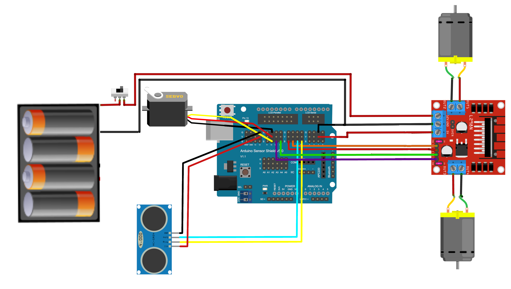
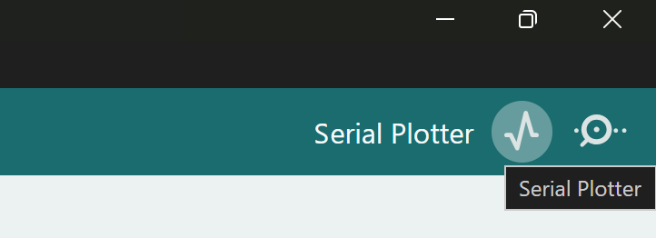

# Teil 2 - Distanz messen mit Ultraschall
> [!NOTE]
> Du lernst, wie der Ultraschallsensor funktioniert, sodass dein Arduino die Distanz zu möglichen Hindernissen messen kann.

## Einführung
Damit unser Roboter auch "smart" wird, muss er seine Umgebung wahrnehmen und passend reagieren können. In diesem Teil beschäftigen wir uns mit dem "Wahrnehmen".

## Aufgabe 2.1 Ultraschallsensor dazubauen

Der Sensor ist auf einem kleinen Servomotor aufgebaut, sodass der Roboter später in verschiedene Richtungen "schauen" kann. Für den Moment interessieren wir uns nur für die Distanz geradeaus.

**Vorgehen**
1. Setze den Servomotor vorne auf deinen Roboter, sodass der Sensor möglichst geradeaus zeigt. Unterstütze dabei die Plexiglasscheibe von unten, damit sie nicht bricht.
2. Studiere das folgende Schema, und verbinde die Kabel des Servos und des Sensors mit dem Sensor Shield:
    - Der Servo hat drei kombinierte Kabel, diese gehen alle auf Pin 10 (S = Signal, V = + Spannung, G = Ground/Erdung).
    - Der Ultraschallsensor benötigt auch Energie (VCC -> V, GND -> G).
    - Zusätzlich muss der Sensor auf Befehl ein Signal aussenden (Trig → 4 S) und danach das reflektierte Echo empfangen (Echo → 5 S).
    


3. Teste nun den folgenden Sketch "DistanzMessung":
```
/**********************************************
  Distanzmessung mit Ultraschallsensor
**********************************************/


//---------------------------------------------
// Globale Konstanten für Motoren/Sensoren
//---------------------------------------------

// Digitale Output/Input Pins für Ultraschallsensor
#define TRIG 4
#define ECHO 5

// Werte für Distanzmessung
int lookLeft = 0; 
int lookRight = 0; 
int lookAhead = 0; 
int timeEcho;  


//---------------------------------------------
// Setup Funktion
//  Wird zur Initialisierung zu Beginn des
//  Programms ausgeführt
//---------------------------------------------
void setup() {
    

    // Die Sensoren-Pins für Trigger und Echo
    pinMode(TRIG, OUTPUT); 
    pinMode(ECHO, INPUT); 

    // damit der Serial Plotter funktioniert
    Serial.begin(9600);
}


//---------------------------------------------
// Loop Funktion
//   Wird nach setup() immer wieder ausgeführt.
//---------------------------------------------
void loop() {

     distanceAhead();
     Serial.println(lookAhead);
     delay(10);

}


/*****************************  Erkunden  *********************************/

            float distanceAhead(){  
                 // Es wird ein Ultraschall Puls der Länge
                 //   10 Mikrosekunden ausgesendet und wieder
                 //   empfangen. Damit das Signal klar und sauber
                 //   ist, wird der Pin zuerst 5 Mikrosekunden lang 
                 //   auf LOW (aus) gesetzt.
                 digitalWrite(TRIG, LOW);
                 delayMicroseconds(5);  
                 digitalWrite(TRIG, HIGH);
                 delayMicroseconds(10);
                 digitalWrite(TRIG, LOW);

                 // Puls empfangen: Die Funktion pulseIn() misst die
                 // Dauer in Mikrosekunden, bis ein Signal der Stärke
                 // HIGH empfangen wird.
                   timeEcho = pulseIn(ECHO, HIGH);

                 // Distanz (cm) mithilfe der Schallgeschwindigkeit berechnen
                   lookAhead = timeEcho/58;
                   return lookAhead;
                   }

            float distanceLeft(){   
                 digitalWrite(TRIG, LOW);
                 delayMicroseconds(5);    
                 digitalWrite(TRIG, HIGH);
                 delayMicroseconds(10);
                 digitalWrite(TRIG, LOW);
                 timeEcho = pulseIn(ECHO, HIGH);
                 lookLeft = timeEcho/58;
                 return lookLeft;
                 }

            float distanceRight(){     
                 digitalWrite(TRIG, LOW);
                 delayMicroseconds(5);     
                 digitalWrite(TRIG, HIGH);
                 delayMicroseconds(10);
                 digitalWrite(TRIG, LOW);
                   timeEcho = pulseIn(ECHO, HIGH);
                   lookRight = timeEcho/58;
                   return lookRight;
                   }
```
Die Zeile `Serial.println(lookAhead);` definiert, dass der Wert von `lookAhead` auf den Serial Plotter gesendet wird. Wir können somit live sehen, welche Distanzen der Ultraschallsensor gerade misst.  



